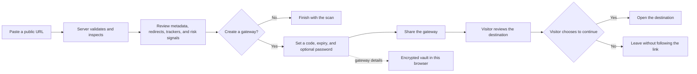

<div align="center">

# LUXLINK

### See the page before you trust the link.

Scan a destination. Understand the risk. Share a gateway that lets people choose before they continue.

[](https://luxlink-8ft40hf6f-chandanlabs-projects.vercel.app)
[](https://www.typescriptlang.org/)
[](https://react.dev/)
[](https://tanstack.com/start)
[](https://vite.dev/)

**[Try the app](https://luxlink-8ft40hf6f-chandanlabs-projects.vercel.app) · [Explore the code](https://github.com/ChandanLabs/LUXLINK) · [Report a bug](https://github.com/ChandanLabs/LUXLINK/issues)**

> **Demo availability:** The deployment may be protected by Vercel and require sign-in. If it does not open publicly, the source and local setup below are available.

</div>

---

## Navigate

[Overview](#overview) · [Features](#features) · [How it works](#how-it-works) · [Privacy and safety](#privacy-and-safety) · [Tech stack](#tech-stack) · [Run locally](#run-locally) · [Configuration](#configuration) · [Scripts](#available-scripts) · [Project layout](#project-layout) · [Contributing](#contributing)

## Overview

Luxlink is a privacy-minded link-safety gateway built as a full-stack web application. Instead of forwarding someone through a short link with no context, Luxlink inspects a public destination and presents a readable preview, redirect path, tracker signals, and risk assessment before the visitor decides whether to continue.

The project combines server-side URL inspection and expiring gateway records with a browser-local encrypted vault. It is designed to make link sharing more transparent—not to claim that automated checks can prove a website is safe.

## Features

| Capability                   | What it does                                                                                                                                                                         |
| ---------------------------- | ------------------------------------------------------------------------------------------------------------------------------------------------------------------------------------ |
| **Link inspection**          | Reads available page metadata, follows and displays redirect hops, and checks for known tracker families.                                                                            |
| **Risk signals**             | Highlights suspicious patterns and explains when a destination could not be verified. Treat the result as guidance, not a guarantee.                                                 |
| **Consent-first gateway**    | Shares a short link that shows destination context before a visitor chooses to continue.                                                                                             |
| **Expiry controls**          | Choose a lifetime or configure a gateway to burn after one opening.                                                                                                                  |
| **Optional password gate**   | Require a password before showing the gateway preview. Password verifiers are stored as hashes, not plaintext.                                                                       |
| **Custom link names**        | Create memorable gateway codes for sharing.                                                                                                                                          |
| **Privacy-minded analytics** | View aggregate click, country, and device counts for a gateway. The app does not store raw IP addresses as click analytics.                                                          |
| **Encrypted local vault**    | Keep created gateway details in this browser, protected with Web Crypto AES-GCM. Import or export a vault when needed. The vault is device-local; it does not sync between browsers. |
| **QR codes and share cards** | Make a gateway easier to open and share, including a branded card when destination artwork is unavailable.                                                                           |
| **Interactive walkthrough**  | Preview the inspect → verify → protect flow in the animated product demo on the landing page.                                                                                        |
| **Responsive interface**     | Use the app on desktop or mobile, with reduced-motion preferences respected.                                                                                                         |

## How it works



1. **Inspect:** Submit a public URL. Luxlink validates the destination and attempts to read its metadata and redirect chain.
2. **Review:** Look at the destination, risk signals, and tracker matches. If the page cannot be inspected, Luxlink marks it unverified rather than presenting a fabricated result.
3. **Create:** Optionally choose a custom code, password, expiry, or one-time opening.
4. **Share:** Send the gateway URL. Visitors see the gateway page and choose whether to continue.
5. **Manage:** Revisit your browser-local vault to copy, export, or manage gateways and see available aggregate analytics.

## Privacy and safety

- URL fetching runs on the server. Private and local network destinations are rejected to help prevent server-side request forgery.
- Link scans are not added to the local vault automatically; a gateway is saved to the vault when you create one.
- The vault is encrypted in the browser with AES-GCM. Its encryption key is also stored in that browser's local storage, so this is **not** protection against a compromised device, browser, or same-origin script.
- Gateway records can contain their destination URL and are stored by the configured server database until expiry or deletion. Do not use Luxlink to share secrets or sensitive personal information.
- Aggregate analytics include click, country, and device counts. Raw IP addresses are not stored as click analytics; request-derived data may be used transiently for rate limiting.
- Risk and tracker checks are heuristic and may miss malicious sites or flag benign ones. A “safe” result is not a security certification. Always verify a destination before entering credentials or payment information.

## Tech stack

| Layer                | Technologies                                                                                 |
| -------------------- | -------------------------------------------------------------------------------------------- |
| UI                   | React 19, TypeScript, Tailwind CSS 4, Radix UI, Lucide                                       |
| Full-stack framework | TanStack Start and TanStack Router                                                           |
| Build and tooling    | Vite, Node.js, npm                                                                           |
| Data                 | PostgreSQL-compatible SQL, Neon when `DATABASE_URL` is configured, PGlite fallback otherwise |
| Browser vault        | Web Crypto API, AES-GCM, `localStorage`                                                      |
| Deployment target    | Vercel-compatible Nitro output                                                               |

## Run locally

### Prerequisites

- Node.js 22 recommended
- npm
- Git

### Install and start

```bash
git clone https://github.com/ChandanLabs/LUXLINK.git
cd LUXLINK
npm install
npm run dev
```

Open the development URL printed by Vite. The app uses an in-memory PGlite database when `DATABASE_URL` is not set; data in this fallback is not durable across server restarts.

### Production build

```bash
npm run typecheck
npm run build
```

The build creates the Vercel-compatible production output. When `DATABASE_URL` is present, the build's migration step applies SQL migrations to that database—use the intended development or production database deliberately.

## Configuration

No environment file is required for the local PGlite fallback. Set optional variables in your shell or hosting provider; never commit secrets.

| Variable       | Required                                                        | Purpose                                                                                                           |
| -------------- | --------------------------------------------------------------- | ----------------------------------------------------------------------------------------------------------------- |
| `DATABASE_URL` | No for local development; recommended for persistent deployment | PostgreSQL connection string. If omitted, the app uses an in-memory PGlite database.                              |
| `XAI_API_KEY`  | No                                                              | Enables optional server-side AI summaries. Keep this secret on the server; never expose it as a `VITE_` variable. |

PowerShell example for the current terminal session:

```powershell
$env:DATABASE_URL = "your-postgresql-connection-string"
$env:XAI_API_KEY = "your-server-side-api-key"
npm run dev
```

For deployment, configure production environment variables in the hosting provider and connect the GitHub repository. Verify that the database is persistent and that migrations have completed before sharing the deployment URL.

## Available scripts

| Command                   | Purpose                                                                   |
| ------------------------- | ------------------------------------------------------------------------- |
| `npm run dev`             | Start the local development server.                                       |
| `npm run typecheck`       | Run the TypeScript compiler without emitting files.                       |
| `npm run lint`            | Lint the project with ESLint.                                             |
| `npm test`                | Run the configured Node.js test suites.                                   |
| `npm run build`           | Build for production and run the database migration step when configured. |
| `npm run db:migrate`      | Apply pending database migrations when `DATABASE_URL` is set.             |
| `npm run preview:restart` | Restart the local preview server for a built application.                 |

## Project layout

```text
src/
  components/       Landing page, gateway, composer, vault UI, and shared components
  lib/              Link inspection, database, auth, vault, and shared models
  routes/           TanStack Start routes
  styles.css        Global styles, design tokens, and motion
migrations/         Link and database schema migrations
scripts/            Build, migration, validation, and preview utilities
server/             Server middleware
public/             Static app assets
```

## Deployment

The current Vercel deployment is linked above. To deploy from GitHub, import [`ChandanLabs/LUXLINK`](https://github.com/ChandanLabs/LUXLINK) into Vercel, configure production environment variables such as `DATABASE_URL`, and deploy the `main` branch. If Vercel Deployment Protection is enabled, configure access in Vercel project settings before treating the URL as a public portfolio demo.

## Contributing

Issues and pull requests are welcome:

1. Fork the repository and create a focused branch.
2. Make the change and add or update tests where appropriate.
3. Run `npm run typecheck`, `npm run lint`, and `npm test`.
4. Open a pull request with a clear summary, screenshots for UI changes, and any relevant test notes.

For a security-sensitive issue, avoid posting exploit details publicly; use GitHub's private vulnerability reporting if it is enabled for the repository, or contact the maintainer privately.

## License

No license file is currently included. Unless a license is added, the source is published for viewing but is not explicitly granted for reuse, modification, or redistribution.
